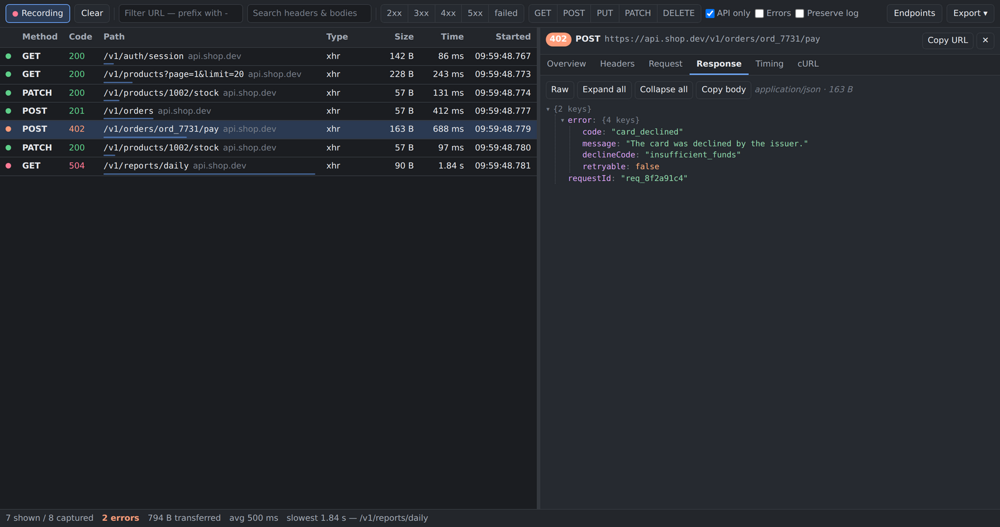

# API Log — Request/Response Inspector

A personal browser extension that adds an **API Log** panel to DevTools, for reading
request and response logs while debugging an API.

It is a focused alternative to the Network tab: API calls only by default, response
bodies pretty-printed as a collapsible tree, search that reaches *into* bodies and
headers, per-endpoint timing stats, copy-as-cURL, and HAR/JSON export.



<sub>The panel follows the DevTools theme — [same view in light](docs/screenshot-light.png).</sub>

---

## เริ่มใช้งาน (Quick start, ภาษาไทย)

1. เปิด `chrome://extensions` (Edge: `edge://extensions`)
2. เปิด **Developer mode** มุมขวาบน
3. กด **Load unpacked** แล้วเลือกโฟลเดอร์นี้ (โฟลเดอร์ที่มี `manifest.json`)
4. เปิดหน้าเว็บที่จะ debug → กด F12 เปิด DevTools → ไปที่แท็บ **API Log**
5. กดใช้งานหน้าเว็บตามปกติ request/response จะไหลเข้ามาในตาราง

> ⚠️ ตัวดักจับทำงานเฉพาะตอนที่ DevTools เปิดอยู่เท่านั้น ถ้าจะดู request ตอนโหลดหน้าแรก
> ให้เปิด DevTools ค้างไว้ก่อนแล้วค่อย reload

---

## Install

Chrome, Edge, Brave, Arc or any other Chromium browser:

1. Go to `chrome://extensions`
2. Turn on **Developer mode**
3. **Load unpacked** → pick this folder (the one containing `manifest.json`)
4. Open DevTools (F12) on the page you are debugging → **API Log** tab

There is no build step. Edit a file, hit **Reload** on the extensions page, reopen
DevTools.

## What it does

**Capture**

- Records every request the inspected tab finishes, with real request *and* response
  bodies.
- **API only** (on by default) keeps XHR, `fetch`, EventSource and WebSocket, and
  hides images, CSS, fonts and scripts.
- **Preserve log** keeps the table across page navigations.
- The record button pauses capture without clearing what you already have.

**Find the call you care about**

- URL filter, with a leading `-` to exclude: `-analytics` hides anything matching it.
- A second search box that looks inside request bodies, response bodies and headers —
  paste an order id and get the one call that mentions it.
- Status-family chips (2xx / 3xx / 4xx / 5xx / failed) and method chips, all
  multi-select.
- **Errors** reduces the table to failures and 4xx/5xx in one click.

**Read the response**

- JSON bodies render as a collapsible tree; **Raw** switches to the exact payload.
- Clicking any key copies its path (`error.declineCode`), ready to paste into code.
- Form-encoded bodies render as a table; binary responses are reported, not dumped.
- Tabs: Overview, Headers, Request, Response, Timing (phase bars), cURL.

**Get it out of the browser**

- **Copy as cURL** rebuilds a replayable command — correct POSIX quoting, HTTP/2
  pseudo-headers and `Content-Length` dropped, `-X GET` kept when a GET carries a body.
- **Download as HAR** (re-importable into DevTools, Insomnia, Postman) or as a flatter
  **JSON** log with bodies already parsed.
- Exports redact `Authorization`, `Cookie`, `X-API-Key` and friends by default; the
  checkbox in the Export menu turns that off. The cURL *tab* always keeps real values,
  since the point there is replaying the call yourself.

**Endpoints view**

Groups calls by method plus normalized path — `/users/42` and `/users/77` collapse into
`/users/:id` — with call count, error count and rate, and min/avg/max duration. This is
the view that answers "which endpoint is slow?" and "which one is quietly failing?".
Click a row to drill back into the filtered request list.

## Keyboard

| Key | Action |
| --- | --- |
| `/` | Focus the URL filter |
| `↑` `↓` (or `k` `j`) | Move through the list |
| `Enter` / `Space` | Open the focused row |
| `Esc` | Close the detail pane, a menu, or blur a field |
| `Ctrl`/`⌘` + `K` | Clear the log |

## How capture works, and what it cannot see

The panel listens to `chrome.devtools.network.onRequestFinished`, the same feed the
Network tab uses. That is the only capture path that sees real response bodies without
injecting code into the page, so the extension needs **no host permissions** and
declares only `storage` (for remembering your filter and layout).

The trade-offs are worth knowing before you chase a ghost:

- **Capture only runs while DevTools is open on that tab.** To see the requests a page
  fires on load, open DevTools first, then reload.
- Only the inspected tab is recorded. Service-worker and extension traffic is not.
- A response body arrives asynchronously, just after the row does; very large bodies may
  be truncated by the browser.
- Nothing leaves your machine. Records live in the panel's memory, capped at 3000
  (oldest dropped), and are gone when you close DevTools unless you export them.

## Firefox

The panel code is already cross-browser (it reads `browser` or `chrome`). Firefox needs
one manifest change — add an add-on id:

```json
"browser_specific_settings": { "gecko": { "id": "api-log@local" } }
```

Then load it from `about:debugging` → **This Firefox** → **Load Temporary Add-on**.

## Layout

```
manifest.json          MV3 manifest; devtools_page + "storage"
devtools/
  devtools.html/.js    registers the panel
  panel.html/.css/.js  the panel itself: capture, rendering, toolbar wiring
src/
  format.js            byte/duration/status formatting
  har.js               HAR entry → record, body parsing, endpoint normalization
  filter.js            the filtering rules behind the toolbar
  stats.js             status-bar totals and endpoint grouping
  curl.js              record → replayable curl command
  exporters.js         HAR 1.2 and JSON serializers, header redaction
  jsonview.js          collapsible JSON tree
  dom.js               element helpers (textContent only, never innerHTML)
test/                  unit tests + a browser smoke test
```

Everything under `src/` is free of DOM and `chrome.*` calls, which is what makes it
testable under plain Node.

## Tests

```bash
npm test        # unit tests for the pure modules (node:test, no dependencies)
npm run test:panel   # drives the real panel in Chromium via Playwright
```

The smoke test serves the repo over HTTP, stubs `chrome.devtools`, feeds the panel fake
HAR entries and asserts the rendered DOM — filtering, the JSON tree, tab switching,
keyboard navigation, clearing, and that the page logged no errors. Point it at another
browser binary with `CHROMIUM_PATH=...`.

## Security notes

- Response bodies are inserted with `textContent` only, never `innerHTML`, so a hostile
  API response cannot execute anything inside the panel.
- No `content_scripts`, no `host_permissions`, no background service worker, no network
  calls of its own.
